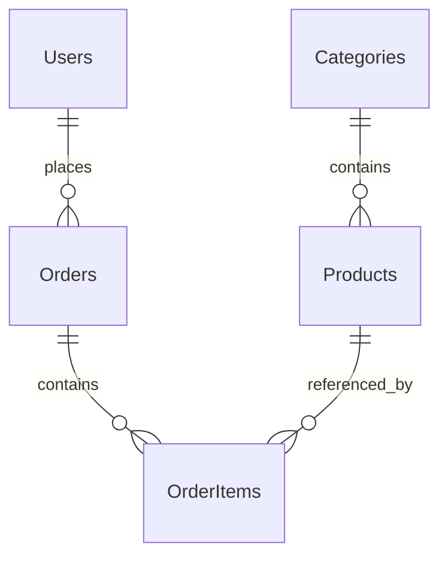

# Database schema 

This schema supports the category-based product catalog and establishes the
relationships needed for users and orders. The source of truth is the EF Core
model in `OnlineStore/Models/` and its Fluent API mappings in
`OnlineStore/Data/Configurations/`. There is no separate handwritten DDL to keep
in sync with migrations.

## Existing repository and scope

The initial repository contains a .NET 8 ASP.NET Core application, static HTML,
and `/api/health`. It has no existing entities, DTOs, database context, database
provider, migrations, or connection strings. The README names MySQL and EF Core
as the intended database stack.

SCRUM-39 adds five entities, an order-status enum, an unregistered
`StoreDbContext`, and EF Core 8 relational mappings. The relational package
provides model configuration APIs; it does not include a MySQL provider.
`Program.cs`, application settings, endpoints, and frontend behavior are unchanged.

SCRUM-40 owns provider installation, connection configuration, context
registration, migrations, database creation, and connection verification.

## MySQL assumptions

- MySQL 8.0.16 or later, with InnoDB tables. Earlier versions do not enforce
  `CHECK` constraints. This schema does not target MariaDB.
- Use `utf8mb4` for the database and tables. The model's default collation is
  `utf8mb4_0900_ai_ci`: text comparisons, including unique category names, SKUs,
  and email addresses, are case-insensitive and accent-insensitive. Order status
  uses `utf8mb4_bin` so its allowed values are case-sensitive.
- Use strict SQL mode so invalid or overlong values fail instead of being
  silently truncated or coerced.
- Money uses C# `decimal` and MySQL `DECIMAL(18,2)`, never floating point.
  All prices use one project-wide currency; the team must choose the currency
  before exposing prices. Multi-currency orders, tax, shipping, and discounts
  are outside this schema's current requirements.
- All IDs and foreign keys use signed `INT`, matching C# `int`. `Id` is each
  table's primary key and is marked `ValueGeneratedOnAdd`; the MySQL provider
  must generate it as `AUTO_INCREMENT` when SCRUM-40 creates migrations.
- `CreatedAt` represents UTC and is initialized with `DateTime.UtcNow` by the
  entity. There is no database timestamp default. MySQL `DATETIME(6)` stores no
  timezone or .NET `DateTime.Kind`; SCRUM-40 configures `DateTimeKind=Utc` on the
  connection so reads have UTC kind. Explicit writes must also use UTC.

## Relationships



Each product requires exactly one category. Each order requires one registered
user; guest checkout is not included. Each order item requires both an order
and a product. A category, user, or product may initially have no dependents.
The database can also temporarily contain an order with no items: requiring at
least one item at checkout is an application rule, not enforced by these foreign
keys.

## Tables

All columns are `NOT NULL` except those explicitly marked nullable. Table and
column names preserve their configured casing; queries should use that casing
on MySQL installations with case-sensitive table names.

### Categories

| Column | MySQL type | Rules |
| --- | --- | --- |
| Id | INT | Primary key; generated on insert |
| Name | VARCHAR(100) | Unique |
| Description | TEXT | Nullable |

`Phones` and `Tablets` are expected initial categories based on the project
README. No category seed data is inserted by this task.

### Products

| Column | MySQL type | Rules |
| --- | --- | --- |
| Id | INT | Primary key; generated on insert |
| CategoryId | INT | Foreign key to Categories.Id |
| Sku | VARCHAR(64) | Unique |
| Name | VARCHAR(200) | Required |
| Description | TEXT | Nullable |
| Price | DECIMAL(18,2) | Must be >= 0 |
| StockQuantity | INT | Must be >= 0; database default 0 |
| ImageUrl | VARCHAR(2048) | Nullable |
| IsActive | TINYINT(1) | C# bool; CLR and database default true |

`TINYINT(1)` is MySQL's representation of `BOOLEAN`. Set `IsActive` to false to
remove a product from the active catalog while retaining order references.
`Sku` identifies a sellable product; product variants are not modeled separately.

### Users

| Column | MySQL type | Rules |
| --- | --- | --- |
| Id | INT | Primary key; generated on insert |
| Name | VARCHAR(100) | Required |
| Email | VARCHAR(254) | Unique under the default collation |
| PasswordHash | VARCHAR(512) | Required; store an encoded password hash only |
| CreatedAt | DATETIME(6) | UTC by convention; CLR default DateTime.UtcNow |

Authentication, email normalization and validation, password hashing, and roles
are future application work. This is a minimal user model, not an ASP.NET Core
Identity implementation. Future API DTOs must exclude `PasswordHash`.

### Orders

| Column | MySQL type | Rules |
| --- | --- | --- |
| Id | INT | Primary key; generated on insert |
| UserId | INT | Foreign key to Users.Id |
| CreatedAt | DATETIME(6) | UTC by convention; CLR default DateTime.UtcNow |
| Status | VARCHAR(20) | String-converted OrderStatus; CLR and database default Pending |

`CK_Orders_Status` permits only `Pending`, `Paid`, `Shipped`, `Completed`, and
`Cancelled`. Adding or renaming an enum member requires updating the check
constraint and generating a migration. Valid status transitions are an
application responsibility.

No total is stored independently. Calculate a merchandise total with
`SUM(OrderItems.UnitPrice * OrderItems.Quantity)` for the order; use zero for an
empty order. Query order items directly or project the sum in the database,
rather than assuming navigation collections are loaded. Do not calculate
historical totals from current product prices.

### OrderItems

| Column | MySQL type | Rules |
| --- | --- | --- |
| Id | INT | Primary key; generated on insert |
| OrderId | INT | Foreign key to Orders.Id |
| ProductId | INT | Foreign key to Products.Id |
| ProductName | VARCHAR(200) | Purchase-time product name snapshot |
| UnitPrice | DECIMAL(18,2) | Purchase-time unit price; must be >= 0 |
| Quantity | INT | Must be > 0 |

The unique `(OrderId, ProductId)` index allows one line per product per order;
multiple units use `Quantity`. Checkout must populate `ProductName` and
`UnitPrice` from the purchase-time product values and preserve those values
after purchase. The schema stores snapshots but does not implement checkout or
enforce snapshot immutability.

## Foreign keys and deletion

| Foreign key | Relationship | ON DELETE |
| --- | --- | --- |
| Products.CategoryId → Categories.Id | Category has many products | RESTRICT |
| Orders.UserId → Users.Id | User has many orders | RESTRICT |
| OrderItems.OrderId → Orders.Id | Order has many items | CASCADE |
| OrderItems.ProductId → Products.Id | Product appears in many order items | RESTRICT |

Category, user, and product deletion fails while references exist. Deleting an
order also deletes its order items. Ordinary cancellation should update order
status instead of deleting order history. Primary keys are stable identifiers;
the design does not require cascading key updates.

## Indexes and checks

Each table has its primary-key index. Additional indexes are:

| Table | Columns | Unique | Purpose |
| --- | --- | --- | --- |
| Categories | Name | Yes | Avoid duplicate category names |
| Products | Sku | Yes | Identify sellable products |
| Products | CategoryId, IsActive, Name | No | Filter active catalog products by category and sort by name |
| Users | Email | Yes | Avoid duplicate accounts and support lookup |
| Orders | UserId, CreatedAt | No | Retrieve a user's order history |
| OrderItems | OrderId, ProductId | Yes | One product line per order; retrieve order lines |
| OrderItems | ProductId | No | Support the product foreign key and product-reference lookups |

Composite indexes cover their leftmost foreign-key columns. EF Core's
conventions therefore do not need additional single-column indexes on
`Products.CategoryId`, `Orders.UserId`, or `OrderItems.OrderId`.

| Check constraint | Expression |
| --- | --- |
| CK_Products_Price | Price >= 0 |
| CK_Products_StockQuantity | StockQuantity >= 0 |
| CK_OrderItems_UnitPrice | UnitPrice >= 0 |
| CK_OrderItems_Quantity | Quantity > 0 |
| CK_Orders_Status | Status IN ('Pending', 'Paid', 'Shipped', 'Completed', 'Cancelled') |

Required strings are non-nullable C# properties with explicit EF `IsRequired`
configuration. Rejecting empty names, validating URLs/emails, and trimming
input remain application validation responsibilities. Inventory reservation,
concurrent stock changes, checkout transactions, and order lifecycle rules are
also outside this schema-only task.

## SCRUM-40 integration and verification

SCRUM-40 adds Pomelo 8.0.3, EF Core design-time tooling 8.0.32, scoped
`StoreDbContext` registration, secure connection configuration, and the initial
migration generated from this model. The [README](../README.md) contains local
MySQL provisioning requirements, User Secrets setup, and exact EF commands.
No entities or relationship definitions are duplicated.

1. Supply the connection string through User Secrets in Development or through
   environment/secret configuration. Confirm the intended development database
   and `MySql:ServerVersion` before applying migrations.
2. Ensure the server/database uses InnoDB, `utf8mb4`, strict SQL mode, and a
   compatible collation.
3. Review the generated migration SQL for `AUTO_INCREMENT`, column types,
   collation inheritance, checks, foreign keys, deletion actions, defaults,
   and indexes before applying it to a local or disposable database.
4. Verify that products can be saved and queried by category. Exercise duplicate
   email/SKU/category/line inserts, orphan foreign keys, negative money/stock,
   zero quantity, unknown status, explicit `IsActive = false`, and the deletion
   rules against real MySQL. Confirm that updating a product does not change
   stored order-item snapshots.

The application can be compiled without a configured database once the .NET 8
SDK is installed:

```sh
dotnet restore OnlineStore/OnlineStore.csproj
dotnet build OnlineStore/OnlineStore.csproj --no-restore
```

There is no existing test project. Real MySQL constraint, migration-application,
and read/write checks require a configured MySQL server; an in-memory provider
would not validate MySQL's relational behavior.

## References

- [EF Core entity properties and column mapping](https://learn.microsoft.com/en-us/ef/core/modeling/entity-properties)
- [EF Core indexes and check constraints](https://learn.microsoft.com/en-us/ef/core/modeling/indexes)
- [EF Core foreign and principal keys](https://learn.microsoft.com/en-us/ef/core/modeling/relationships/foreign-and-principal-keys)
- [MySQL 8.0 CHECK constraints](https://dev.mysql.com/doc/refman/8.0/en/create-table-check-constraints.html)
