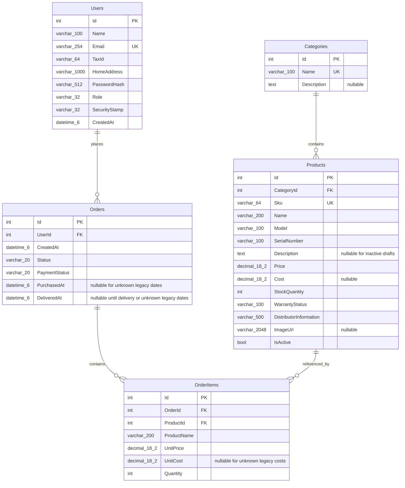

# Database schema

The EF Core entities, Fluent API configurations and migration snapshot define
what is implemented. This document describes the current schema; the
[full target ER design](database-target.md) covers the remaining course domain.
See [requirements traceability](project-requirements.md) for all 18 requirements.

## Implemented schema

Migrations create 22 tables. The first five are described below; `AddFullEcommerceSchema`
(SCRUM-97) adds the other 17, see [Full e-commerce schema](#full-e-commerce-schema-scrum-97).
`AddProductDetailsAndCost` extends the original product model. AlignOrderLifecycle separates
payment and fulfillment; RequireActiveProductDetails protects published catalog records. Apply the full
chain; do not replace an already applied initial migration. Development sample data is loaded explicitly with `--seed`.



`EffectiveCost` is a calculated C# property, not a stored column: configured
Cost or 50% of the current Price, rounded to two decimals. OrderItems.UnitCost
preserves purchase-time cost; unknown legacy costs remain null. New snapshots use the explicit cost or 50% of the final paid price.

## Types and conventions

- MySQL 8.0.16+, InnoDB, strict SQL mode, `utf8mb4_0900_ai_ci`. MariaDB is not
  an equivalent migration target. Text uniqueness is case- and accent-insensitive;
  order Status explicitly uses `utf8mb4_bin` for case-sensitive enum values.
- IDs/FKs use signed INT. Primary keys are generated with AUTO_INCREMENT.
- Money is DECIMAL(18,2) / C# decimal; the storefront uses TRY.
- DATETIME(6) values are UTC. CreatedAt defaults to DateTime.UtcNow in C#;
  no database timestamp default exists. The connection materializes UTC values.
- All fields are required except those marked nullable. Active products must
  pass ProductCatalogValidation on SaveChanges and the CK_Products_ActiveDetails
  SQL check. Inactive drafts and legacy customer fields
  may still be incomplete; profile/checkout validation must require real input.
- Model, SerialNumber, WarrantyStatus and DistributorInformation were added with
  empty defaults to preserve older rows. RequireActiveProductDetails deactivates
  incomplete legacy records while preserving them and their order references. Complete real details before
  reactivation. Rolling back that check does not reactivate incomplete records.
  SerialNumber has no unique index; the product-level field is not a separate
  physical-inventory model.

## Relationships and deletion

SCRUM-48 adds Role (default Customer, checked against exactly the four basic
roles, case-sensitive) and SecurityStamp (a random session-revocation value).
Password, role changes and logout rotate the stamp. Authentication revalidates
the stored role/stamp; no public endpoint accepts a staff role. Legacy accounts
receive an empty stamp through the migration and get a random one only after
successful password verification. Invalid legacy password strings cannot log in.

SCRUM-71 adds required TaxId (64 characters) and HomeAddress (1000 characters)
to Users. New/updated customer profiles must pass CustomerProfileValidation,
including nonblank fields and a valid email address. The migration fills these
columns with empty strings on legacy accounts: their real details must be
completed by the owner; no fictional tax IDs or addresses are invented. TaxId is
not unique (the PDF does not require uniqueness); Email remains unique under the
database collation. Profile DTOs exclude PasswordHash and are owner-only data.

| Foreign key | ON DELETE |
| --- | --- |
| Products.CategoryId → Categories.Id | RESTRICT |
| Orders.UserId → Users.Id | RESTRICT |
| OrderItems.OrderId → Orders.Id | CASCADE |
| OrderItems.ProductId → Products.Id | RESTRICT |

A product has one category; an order has one registered user; each line has one
order and one product. Guest carts belong to the later tables below.
An order may temporarily have zero lines; checkout must require nonempty orders.
Deactivate historical products using IsActive=false. Cancellation changes status,
not order deletion. Future invoice/delivery/refund references must preserve history.

| Table | Additional index | Unique |
| --- | --- | --- |
| Categories | Name | yes |
| Products | Sku | yes |
| Products | CategoryId, IsActive, Name | no |
| Users | Email | yes |
| Orders | UserId, CreatedAt | no |
| OrderItems | OrderId, ProductId | yes |
| OrderItems | ProductId | no |

Composite indexes cover their leftmost FK columns. There is one line per
product/order; multiple units use Quantity.

| Check | Expression |
| --- | --- |
| CK_Products_Price | Price >= 0 |
| CK_Products_Cost | Cost IS NULL OR Cost >= 0 |
| CK_Products_StockQuantity | StockQuantity >= 0 |
| CK_Products_ActiveDetails | Inactive draft, or nonblank SKU/name/model/serial/description/warranty/distributor; active description cannot be null |
| CK_OrderItems_UnitPrice | UnitPrice >= 0 |
| CK_OrderItems_UnitCost | UnitCost IS NULL OR UnitCost >= 0 |
| CK_OrderItems_Quantity | Quantity > 0 |
| CK_Orders_Status | Status IN ('Processing', 'InTransit', 'Delivered', 'Cancelled') |
| CK_Orders_PaymentStatus | PaymentStatus IN ('Pending', 'Confirmed', 'Failed', 'Refunded', 'Unknown') |
| CK_Orders_FulfillmentPayment | InTransit requires Confirmed payment; Delivered requires Confirmed or Refunded payment |

ProductName and UnitPrice are purchase-time snapshots. Calculate order totals
from line UnitPrice × Quantity, not today's product prices. Refunds preserve the
paid price, including any discount.

## Order lifecycle

Fulfillment uses Processing → InTransit → Delivered, with cancellation only from
Processing. Payment is stored separately. Domain methods guard transitions and
preserve the UTC purchase/delivery timestamps. See [the lifecycle contract](order-lifecycle.md)
for legacy status mapping, return eligibility and unknown historical values.

The guarded domain model does not itself implement payment, stock transactions,
invoice creation or delivery APIs. SCRUM-97 supplies the tables; SCRUM-72/73/74/79 supply
the application services under the [Sprint 2 plan](sprint-2-mvp.md).

## Full e-commerce schema (SCRUM-97)

One extension migration, `AddFullEcommerceSchema`, adds the rest of the course domain on
top of the existing chain. It only adds: Users, the customer fields, `Orders.Status` /
`PaymentStatus` and the lifecycle domain methods from `AlignOrderLifecycle` are unchanged,
and no existing order is rewritten.

| Area | New tables |
| --- | --- |
| Checkout | Discounts, DiscountProducts, Payments, Invoices, Deliveries, DeliveryItems |
| Shopping | Carts, CartItems, WishlistItems |
| Feedback | Ratings, Comments |
| After sales | ReturnRequests, Refunds, Notifications |
| Support | Conversations, ChatMessages, ChatAttachments |

What changed on the existing tables:

- **Orders** gain customer snapshots (name, tax ID, email, address) and a `RowVersion` that
  MySQL updates on every change. A purchased order (`PurchasedAt` set) must carry all four
  snapshots (`CK_Orders_PurchaseSnapshot`). Older orders keep `NULL` snapshots, as they keep a
  `NULL` `PurchasedAt`; nothing is invented for them.
- **OrderItems** gain an optional `DiscountId`: the discount applied when the product was bought.
- **Payments** are the individual payment attempts of an order (`Pending`, `Confirmed`, `Failed`);
  `Orders.PaymentStatus` stays the summary of the order. No card data is stored, and a unique
  `IdempotencyKey` makes a retried payment safe.
- **Invoices** store a name, tax ID and address snapshot, so a later profile edit never changes
  an issued invoice. **Deliveries** store an address snapshot and use the `OrderStatus` values.

Rules the database enforces: status columns are text with a CHECK listing every allowed value;
money is `decimal(18,2)` (a discount rate is `decimal(5,4)`, above 0 and at most 1); timestamps
are UTC `datetime(6)`; a rating is 1 to 5 stars; a cart or chat belongs to exactly one owner (user
or hashed guest token); an approved comment, return or active chat names the person who handled
it. Invoices, payments, deliveries, ratings, comments, returns and refunds use ON DELETE
RESTRICT, so deleting a product, user or order never destroys paid history. Only owned drafts
cascade (cart lines, delivery lines, chat messages and attachments, wishlist, notifications).
Deleting a cart sets the chat's `CartId` to null. A refund is unique per return request.

Rules that stay in the service layer, because MySQL cannot express them: one open cart per owner,
that a rating or comment refers to a delivered line of the same user and product, cumulative
returned quantity, and the 30-day return window counted from `PurchasedAt`.

`Down` drops tables and columns, so the migration user also needs the DROP privilege.

### Tests

`SchemaModelTests` read the EF model and run in CI: the table list, status checks against the
enums, delete behaviors, unique keys, money and time types, snapshot lengths, and that the
migrations match the model. `SchemaMySqlTests` and `MySqlIntegrationTests` prove on a real MySQL
that the constraints are enforced; they run only when `ONLINESTORE_TEST_MYSQL` points to a local
database ending in `_tests`.

## Verification

```sh
dotnet restore cs308.sln
dotnet build cs308.sln --no-restore
dotnet test cs308.sln --no-build
dotnet tool restore
dotnet ef migrations has-pending-model-changes --project OnlineStore
dotnet ef migrations script --project OnlineStore --output /tmp/onlinestore-schema.sql
```

EF commands require the connection configuration in the [README](../README.md).
Apply migrations and seed a disposable real MySQL database. Exercise duplicate
keys, orphan FKs, negative money/stock, zero line quantity, unknown statuses,
deletions and purchase snapshots. InMemory tests cannot prove relational
constraints, MySQL collation or migration compatibility.

## References

- [EF Core properties](https://learn.microsoft.com/en-us/ef/core/modeling/entity-properties)
- [EF Core indexes and checks](https://learn.microsoft.com/en-us/ef/core/modeling/indexes)
- [MySQL check constraints](https://dev.mysql.com/doc/refman/8.4/en/create-table-check-constraints.html)
