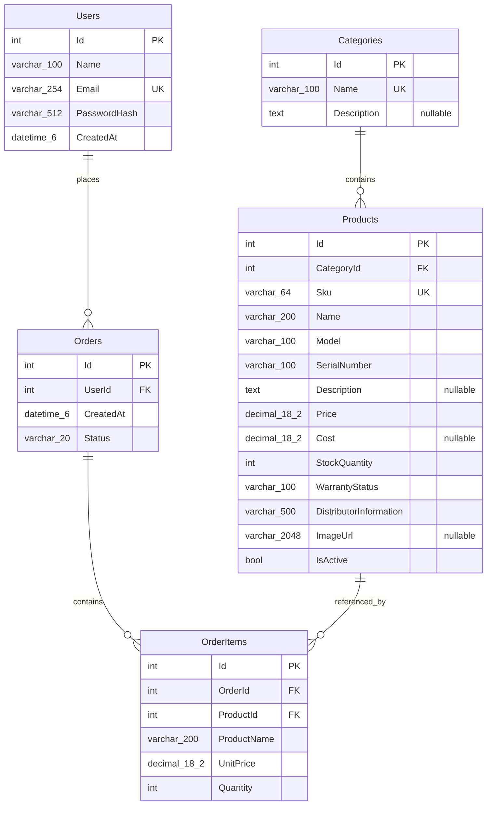

# Database schema

The EF Core entities, Fluent API configurations and migration snapshot define
what is implemented. This document describes the current schema; the
[full target ER design](database-target.md) covers the remaining course domain.
See [requirements traceability](project-requirements.md) for all 18 requirements.

## Implemented schema

Migrations create five tables. `AddProductDetailsAndCost` extends the original
product model. Apply the full chain; do not replace an already applied initial
migration. Development sample data is loaded explicitly with `--seed`.



`EffectiveCost` is a calculated C# property, not a stored column: configured
Cost or 50% of the current Price, rounded to two decimals. Historical profit
requires a purchase-time order-line cost snapshot (target design).

## Types and conventions

- MySQL 8.0.16+, InnoDB, strict SQL mode, `utf8mb4_0900_ai_ci`. MariaDB is not
  an equivalent migration target. Text uniqueness is case- and accent-insensitive;
  order Status explicitly uses `utf8mb4_bin` for case-sensitive enum values.
- IDs/FKs use signed INT. Primary keys are generated with AUTO_INCREMENT.
- Money is DECIMAL(18,2) / C# decimal; the storefront uses TRY.
- DATETIME(6) values are UTC. CreatedAt defaults to DateTime.UtcNow in C#;
  no database timestamp default exists. The connection materializes UTC values.
- All fields are required except those marked nullable. Required strings can
  still be empty in SQL; application validation must reject missing input.
- Model, SerialNumber, WarrantyStatus and DistributorInformation were added with
  empty defaults to preserve older rows. Complete legacy records before treating
  them as valid new products. SerialNumber has no unique index; the product-level
  field is not a separate physical-inventory model.

## Relationships and deletion

| Foreign key | ON DELETE |
| --- | --- |
| Products.CategoryId → Categories.Id | RESTRICT |
| Orders.UserId → Users.Id | RESTRICT |
| OrderItems.OrderId → Orders.Id | CASCADE |
| OrderItems.ProductId → Products.Id | RESTRICT |

A product has one category; an order has one registered user; each line has one
order and one product. Guest carts are not implemented by these five tables.
An order may temporarily have zero lines; checkout must require nonempty orders.
Deactivate historical products using IsActive=false. Cancellation changes status,
not order deletion. Future invoice/delivery/refund references must preserve history.

| Table | Additional index | Unique |
| --- | --- | --- |
| Categories | Name | yes |
| Products | Sku | yes |
| Products | CategoryId, IsActive, Name | no |
| Users | Email | yes |
| Orders | UserId, CreatedAt | no |
| OrderItems | OrderId, ProductId | yes |
| OrderItems | ProductId | no |

Composite indexes cover their leftmost FK columns. There is one line per
product/order; multiple units use Quantity.

| Check | Expression |
| --- | --- |
| CK_Products_Price | Price >= 0 |
| CK_Products_Cost | Cost IS NULL OR Cost >= 0 |
| CK_Products_StockQuantity | StockQuantity >= 0 |
| CK_OrderItems_UnitPrice | UnitPrice >= 0 |
| CK_OrderItems_Quantity | Quantity > 0 |
| CK_Orders_Status | Status IN ('Pending', 'Paid', 'Shipped', 'Completed', 'Cancelled') |

ProductName and UnitPrice are purchase-time snapshots. Calculate order totals
from line UnitPrice × Quantity, not today's product prices. Refunds preserve the
paid price, including any discount.

## Lifecycle gap

The existing enum differs from the required Processing → InTransit → Delivered
fulfillment lifecycle. Cancellation is only allowed while Processing. Payment
confirmation needs a separate state. A migration must preserve legacy paid/unpaid
information rather than blindly collapsing enum values. Address/cost snapshots,
payments, invoices, deliveries, reviews, refunds and chat belong to the target
model and their implementation tasks; a diagram alone does not implement them.

## Verification

```sh
dotnet restore cs308.sln
dotnet build cs308.sln --no-restore
dotnet test cs308.sln --no-build
dotnet tool restore
dotnet ef migrations has-pending-model-changes --project OnlineStore
dotnet ef migrations script --project OnlineStore --output /tmp/onlinestore-schema.sql
```

EF commands require the connection configuration in the [README](../README.md).
Apply migrations and seed a disposable real MySQL database. Exercise duplicate
keys, orphan FKs, negative money/stock, zero line quantity, unknown statuses,
deletions and purchase snapshots. InMemory tests cannot prove relational
constraints, MySQL collation or migration compatibility.

## References

- [EF Core properties](https://learn.microsoft.com/en-us/ef/core/modeling/entity-properties)
- [EF Core indexes and checks](https://learn.microsoft.com/en-us/ef/core/modeling/indexes)
- [MySQL check constraints](https://dev.mysql.com/doc/refman/8.4/en/create-table-check-constraints.html)
