# Full e-commerce data model

This is the **target design** for SCRUM-97 and the feature owners, derived from
Course Project.pdf requirements 1–18. SCRUM-97 implemented it as 22 tables (see the
[implemented schema](database-schema.md)); where the two differ, the implemented schema
wins. New fields/entities require reviewed EF migrations; this is not a second,
handwritten DDL.

## Identity: customers and staff share one account table

Keep **one Users table** for account ID, name, unique email, password hash,
security stamp and role. The PDF describes a store with Customer, SalesManager,
ProductManager and SupportAgent roles, not independent marketplace sellers.
SalesManager controls prices/discounts; ProductManager controls catalog/stock and
delivery. Neither requires a second login table or a seller-owned storefront.

The current checked UserRole enum is adequate for one basic role per account.
If multiple roles per identity become an agreed requirement, add Roles/UserRoles
and adapt authorization explicitly instead of duplicating account credentials.
Role-specific information can later live in one-to-one CustomerProfiles or
StaffProfiles keyed by Users.Id if it grows. The current TaxId/HomeAddress fields
can remain on Users; customer registration/profile validation requires them.
Orders reference the account owner and the service enforces Customer privileges;
staff access must never grant ownership of another customer's order.

The table count follows responsibilities and integrity rules. The existing five
tables are enough only for the initial catalog/order foundation. The purchasing
MVP needs cart, payment, invoice and delivery persistence (and reliable email
delivery state); the full PDF also needs reviews, wishlist/discounts, returns,
refunds and protected chat/attachments. The diagram below is that target, not
proof that its additional tables already exist.

## Target relationships

```mermaid
erDiagram
    Categories ||--o{ Products : contains
    Users o|--o{ Carts : owns
    Carts ||--o{ CartItems : contains
    Products ||--o{ CartItems : selected_in
    Users ||--o{ WishlistItems : saves
    Products ||--o{ WishlistItems : wished_for
    Users ||--o{ Orders : places
    Orders ||--|{ OrderItems : purchases
    Products ||--o{ OrderItems : snapshots
    Orders ||--o{ Payments : attempts
    Orders ||--o| Invoices : invoiced_as
    Orders ||--o{ Deliveries : ships_in
    Deliveries ||--|{ DeliveryItems : contains
    OrderItems ||--o{ DeliveryItems : fulfills
    Users ||--o{ Ratings : rates
    Products ||--o{ Ratings : receives
    OrderItems ||--o{ Ratings : proves_purchase
    Users ||--o{ Comments : writes
    Products ||--o{ Comments : receives
    OrderItems ||--o{ Comments : proves_purchase
    Users o|--o{ Comments : moderates
    Discounts ||--|{ DiscountProducts : applies_to
    Products ||--o{ DiscountProducts : discounted_by
    Discounts o|--o{ OrderItems : applied_at_purchase
    Users ||--o{ Notifications : notified
    Products o|--o{ Notifications : concerns
    OrderItems ||--o{ ReturnRequests : returned_in_part
    Users ||--o{ ReturnRequests : requests
    Users o|--o{ ReturnRequests : reviews
    ReturnRequests ||--o| Refunds : refunded_as
    Payments ||--o{ Refunds : reverses
    Users o|--o{ Conversations : starts
    Users o|--o{ Conversations : claims_as_agent
    Carts o|--o{ Conversations : cart_context
    Conversations ||--o{ ChatMessages : contains
    Users o|--o{ ChatMessages : sends
    ChatMessages ||--o{ ChatAttachments : attaches
    Users {
        int Id PK
        string Name
        string Email UK
        string TaxId
        string HomeAddress
        string PasswordHash
        string Role "Customer SalesManager ProductManager SupportAgent"
    }
    Carts {
        int Id PK
        int UserId FK "nullable for guest"
        string GuestTokenHash UK "nullable for account cart"
        string State
        datetime UpdatedAt
    }
    CartItems {
        int Id PK
        int CartId FK
        int ProductId FK
        int Quantity
    }
    WishlistItems {
        int UserId PK,FK
        int ProductId PK,FK
        datetime AddedAt
    }
    Orders {
        int Id PK
        int UserId FK
        datetime PurchasedAt "nullable until paid or unknown for legacy"
        string Status
        string PaymentStatus
        string CustomerNameSnapshot
        string TaxIdSnapshot
        string EmailSnapshot
        string AddressSnapshot
    }
    OrderItems {
        int Id PK
        int OrderId FK
        int ProductId FK
        int DiscountId FK "nullable"
        string ProductName
        decimal UnitPrice
        decimal UnitCost "nullable only for unknown legacy cost"
        int Quantity
    }
    Payments {
        int Id PK
        int OrderId FK
        string IdempotencyKey UK
        string ProviderReference UK
        decimal Amount
        string Status
        datetime ConfirmedAt "nullable"
    }
    Invoices {
        int Id PK
        int OrderId FK,UK
        string InvoiceNumber UK
        string CustomerNameSnapshot
        string TaxIdSnapshot
        string AddressSnapshot
        string ProtectedDocumentKey
        datetime IssuedAt
        datetime EmailedAt "nullable"
    }
    Deliveries {
        int Id PK
        int OrderId FK
        string AddressSnapshot
        string Status
        datetime DeliveredAt "nullable"
    }
    DeliveryItems {
        int DeliveryId PK,FK
        int OrderItemId PK,FK
        int Quantity
        decimal TotalPriceSnapshot
    }
    Ratings {
        int Id PK
        int UserId FK
        int ProductId FK
        int OrderItemId FK
        int Stars
    }
    Comments {
        int Id PK
        int UserId FK
        int ProductId FK
        int OrderItemId FK
        int ModeratedByUserId FK "nullable"
        text Body
        string ApprovalStatus
        datetime ModeratedAt "nullable"
    }
    Discounts {
        int Id PK
        decimal Rate
        datetime StartsAt
        datetime EndsAt
    }
    DiscountProducts {
        int DiscountId PK,FK
        int ProductId PK,FK
    }
    ReturnRequests {
        int Id PK
        int OrderItemId FK
        int UserId FK
        int ReviewedByUserId FK "nullable"
        int Quantity
        string Status
        datetime RequestedAt
        datetime ReceivedAt "nullable"
    }
    Refunds {
        int Id PK
        int ReturnRequestId FK,UK
        int PaymentId FK
        string IdempotencyKey UK
        decimal Amount
        datetime RefundedAt
    }
    Conversations {
        int Id PK
        int CustomerUserId FK "nullable for guest"
        int ClaimedByUserId FK "nullable until claimed"
        int CartId FK "nullable"
        string GuestTokenHash "nullable"
        string Status
        datetime CreatedAt
    }
    ChatMessages {
        int Id PK
        int ConversationId FK
        int SenderUserId FK "nullable for guest"
        text Body "nullable when attachment only"
        datetime SentAt
    }
    ChatAttachments {
        int Id PK
        int ChatMessageId FK
        string ProtectedStorageKey
        string OriginalFileName
        string ContentType
        long SizeBytes
    }
    Notifications {
        int Id PK
        int UserId FK
        int ProductId FK "nullable"
        string Kind
        string DeduplicationKey UK
        datetime SentAt "nullable"
    }
```

Products and Categories retain all fields in the implemented diagram; Users
retain CreatedAt and SecurityStamp; Orders retain the separate payment/fulfillment
contract and known purchase/delivery timestamps. New mutable entities also need UTC timestamps/concurrency
tokens. Roles are fixed by the PDF: a checked string enum with explicit policies
is sufficient; a configurable permissions editor is not required.

## Integrity and business rules

| Area | Required keys, constraints and service invariants |
| --- | --- |
| Guest carts | Exactly one owner: UserId or hashed high-entropy guest token. One open cart per owner. Unique (CartId, ProductId); positive Quantity. Transactional stock-aware merge on login |
| Checkout | Registered customer; nonempty lines; active products; guarded atomic stock changes in a transaction. Snapshot name, paid price, cost, customer data and address |
| Payments | Nonnegative amount; unique idempotency key/provider reference; idempotent confirmation. No persisted PAN/CVV |
| Invoices | One per confirmed order; unique number; protected PDF storage; authenticated owner/authorized-manager downloads. Email retries do not issue duplicate invoices |
| Fulfillment | Processing → InTransit → Delivered; cancel only Processing. DeliveryItems must belong to the delivery's order. Total delivered quantity cannot exceed ordered quantity; all lines complete before order Delivered |
| Reviews | Stars 1–5; delivered order line owned by same user and referencing same product. Unique (UserId, ProductId) for each review type. Rating visible immediately; Comment defaults Pending; only ProductManager approves/rejects |
| Wishlist/discount | Composite wishlist key. 0 < Rate <= 1; EndsAt > StartsAt. Define one applicable campaign for overlapping discounts; preserve original paid price on order items |
| Returns/refunds | Delivered item; request within 30 days of PurchasedAt, not DeliveredAt. Positive return quantity; cumulative returns <= purchased. SalesManager confirms receipt before authorization. Refund original UnitPrice × Quantity; restock/refund exactly once; deduct actual refunds from revenue |
| Support | Resolve profile/cart/orders/wishlist from authenticated conversation owner, never arbitrary supplied IDs. Guests get no account context. Atomic exclusive agent claim. Only owner/claimed SupportAgent may send/read/download. Validate file types/sizes; store attachments outside wwwroot |
| History | RESTRICT historical references or soft-delete. Cascading owned draft cart lines is fine; deleting a product/account must not cascade into paid orders, invoices, deliveries or refunds |

Purchase eligibility, matching delivery orders, cumulative returns and concurrent
stock updates need service validation and transactions as well as foreign keys.
InMemory tests do not enforce relational checks or prove concurrency.

## Migration order

1. Keep the original migrations and the customer/role/order-lifecycle extensions.
   New identity, payment and order data must reuse these types rather than creating
   parallel Customer/Seller credential tables or resetting the migration history.
2. SCRUM-97 introduced the full schema extension (`AddFullEcommerceSchema`) on top of
   the payment/fulfillment separation, without rewriting existing orders.
3. Implement the checkout/delivery, review, wishlist/discount, refund and support
   services in their separate tasks. Persist cost/price/address snapshots at the
   correct transaction boundary.
4. Test the full chain on fresh MySQL and upgrades containing representative
   data. SCRUM-97's “one migration” means one new extension migration, not deleting
   already applied migrations. Verify FK/check/unique/delete/concurrency behavior
   against real MySQL, not only EF InMemory.
