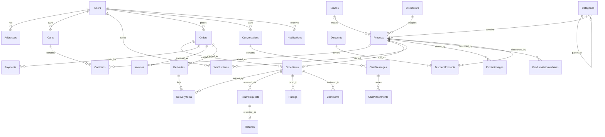
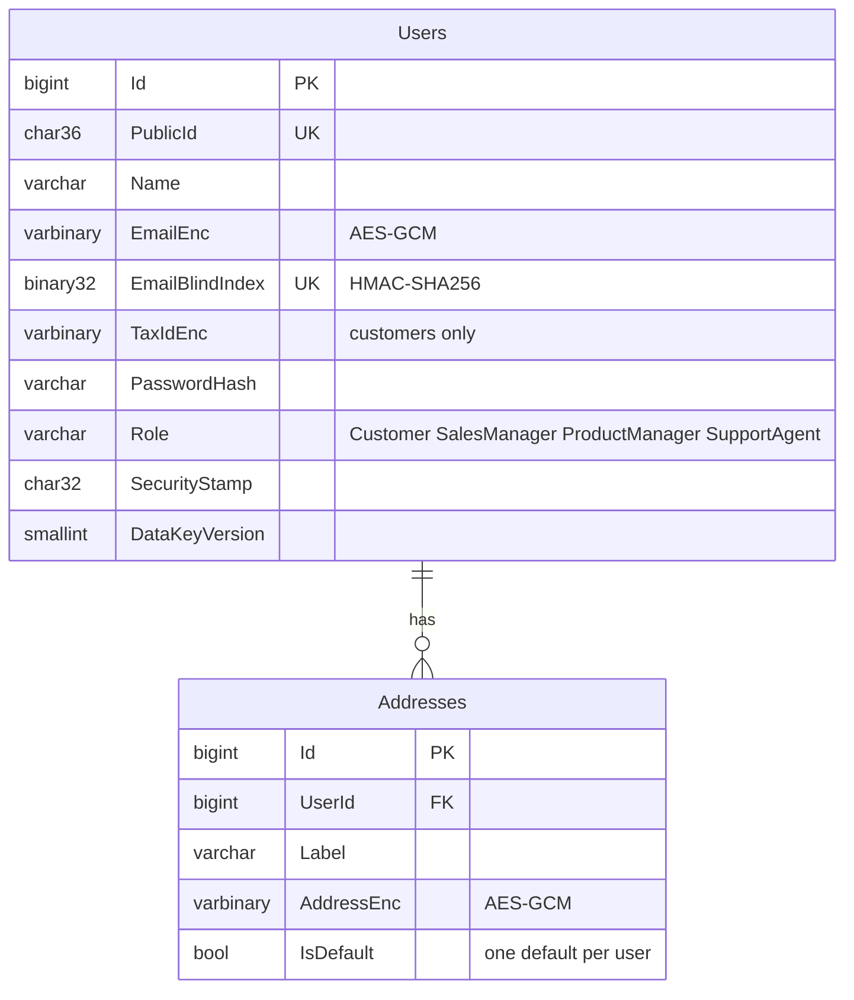
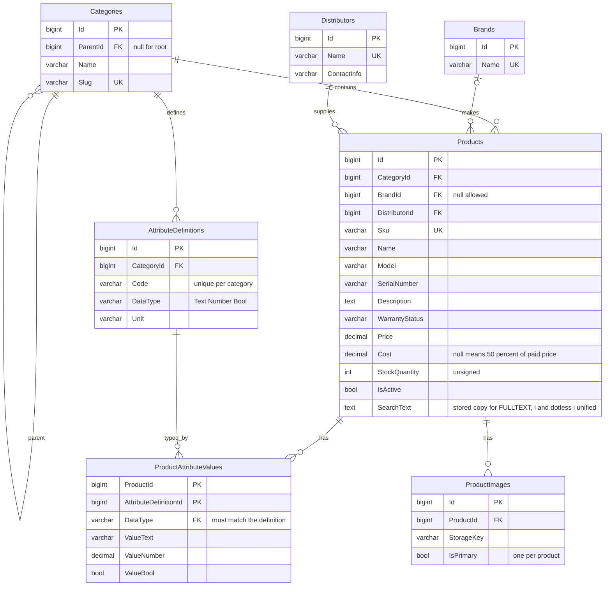
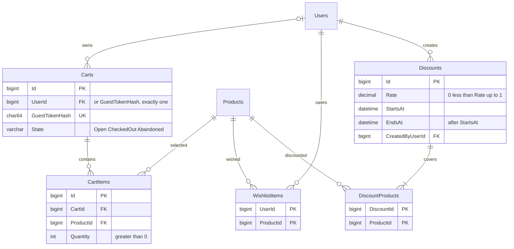
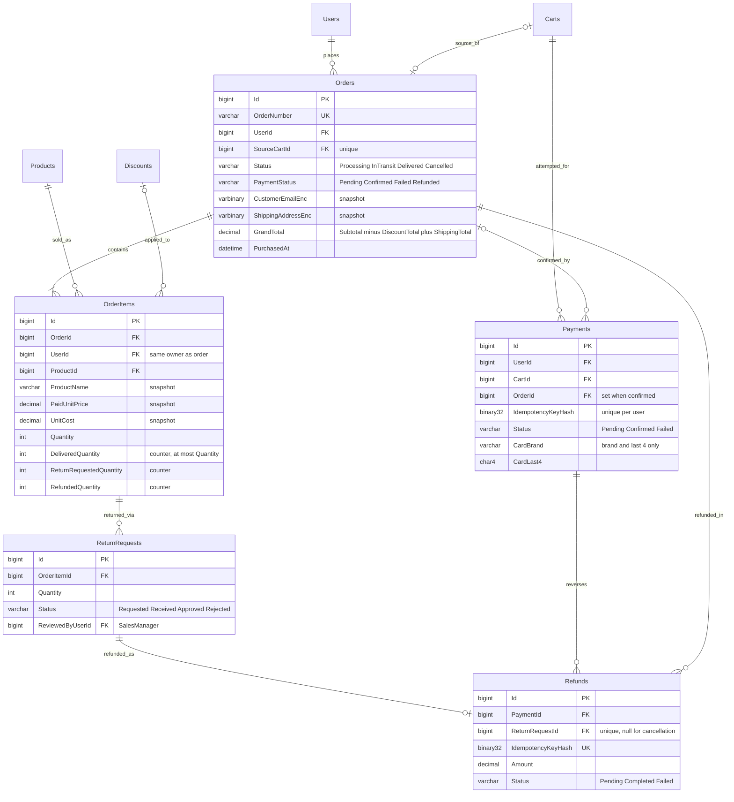
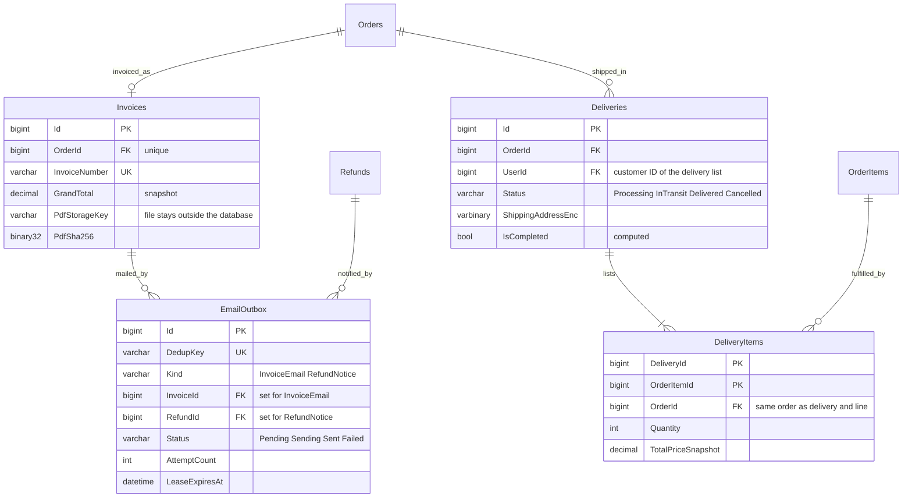
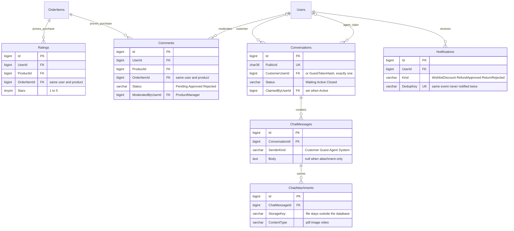

# ER diagrams (29 tables)

Source of truth: `schema.sql`. Tags: **CORE** = required by a PDF requirement, **EXT** = catalog tables
added for the "more diverse electronics" feedback. Mermaid renders on GitHub.
`||--o{` = one-to-many, `|o--o{` = optional one-to-many, `||--o|` = one-to-zero-or-one.

## 0. Overview

## 1. Identity (Users, Addresses)

## 2. Catalog (Categories, Brands, Distributors, Products, specs, images)

## 3. Discounts, cart and wishlist

## 4. Orders, payments, returns and refunds

## 5. Invoices, e-mail outbox and delivery

## 6. Ratings, comments, support chat and notifications

