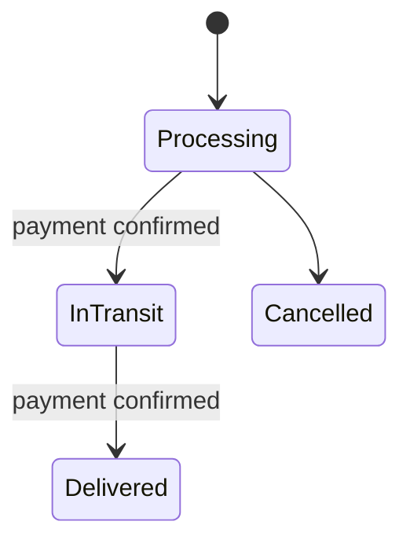

# Order and payment lifecycle

Course Project.pdf requires processing, in-transit and delivered fulfillment,
cancellation only during processing, and returns of delivered products within
30 days of purchase. Payment and fulfillment are separate concerns.

OrderStatus values are Processing, InTransit, Delivered, Cancelled. PaymentStatus
values are Pending, Confirmed, Failed, Refunded and Unknown (legacy reconciliation).
The database checks allowed values and blocks unpaid shipping/delivery. Refunded
is compatible with an already delivered order, not an in-transit shipment.

## Domain operations

- `Order.ConfirmPayment(utcTime)` confirms a pending/failed payment once and
  preserves PurchasedAt on retry. It cannot confirm a cancelled order.
- `Order.RecordPaymentFailure()` leaves fulfillment Processing and does not set
  a purchase date. Confirmation may be retried through the checkout service.
- `Order.TransitionTo(target, utcTime)` allows only the diagram's transitions;
  it rejects unpaid shipments, skipping delivery stages, reversals and changes
  after cancellation/delivery. DeliveredAt is recorded on delivery.
- `Order.CanRequestReturn(utcTime)` requires delivery, confirmed payment, a known
  PurchasedAt, and an elapsed interval of no more than 30 days from purchase.
  Delivery does not restart the clock. Future partial-return services must also
  validate item ownership, delivered/returned quantities and manager approval.
- `OrderItem.Snapshot(product, quantity, paidUnitPrice)` copies name, final paid
  unit price and unit cost. The server supplies the optional discounted price;
  otherwise Product.Price is used. Cost is the explicit product cost, or 50% of
  the paid price by default. The factory does not modify the tracked product.
  Later product/discount changes do not change the purchase snapshot.

All operation timestamps must be UTC. These methods are domain guards; they do
not call a bank, change inventory, create invoices or implement delivery endpoints.
SCRUM-72/79 now persist checkout and delivery operations with transactions and
permissions; see [purchasing.md](purchasing.md) for API/locking/retry contracts.
The mock payment adapter is replaceable by SCRUM-73.
Checkout must conditionally decrement stock in the same finalization transaction,
reject price/owner tampering and deduplicate requests. A failed payment/transaction
must leave no permanent stock decrement or confirmed purchase.

Cancellation after payment still needs the application cancellation/refund service
to reverse financial/inventory effects; changing an enum alone is not a refund.

## Schema history

The earlier combined order status (Pending, Paid, Shipped, Completed, Cancelled)
was split into fulfillment and payment status before the database redesign.
The `AlignOrderLifecycle` migration is no longer part of the repository: the
SCRUM-119 baseline `RedesignedStore` starts from an empty database and does not
convert existing data. The previous migration chain is available in Git at
`3acc716`. See [migration-notes.md](db-redesign/migration-notes.md) for the reset
contract and the current column mappings.
